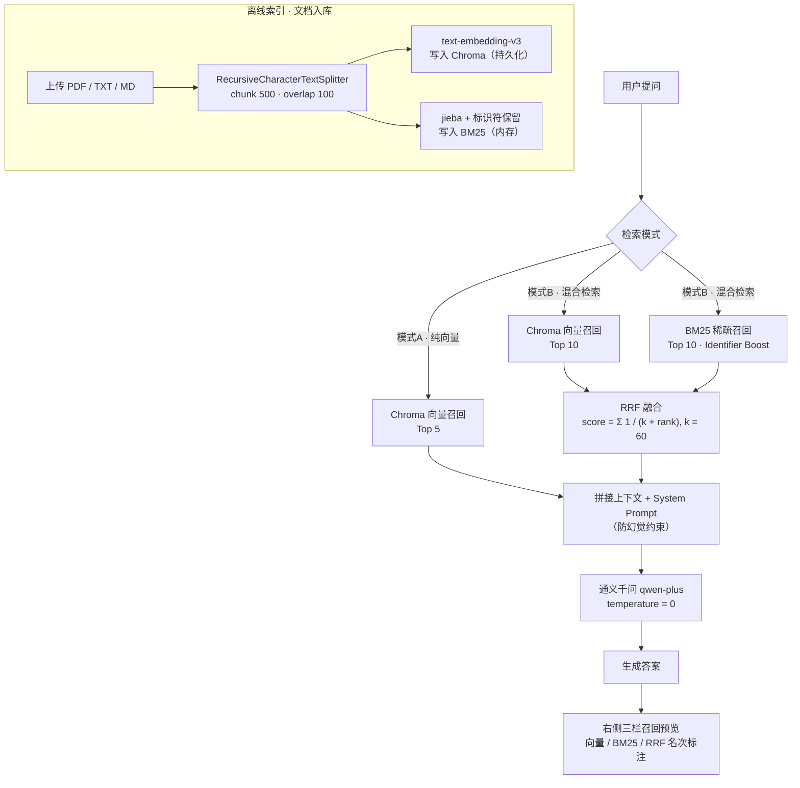

# 混合检索 RAG 知识库问答助手（BM25 + RRF 融合）

> 一个可**现场对照**的 RAG 检索实验台：同一次提问，同屏展示「纯向量召回 / BM25 稀疏召回 / RRF 融合」三路结果与最终答案，并提供纯向量（模式A）与混合检索（模式B）双模式切换，用于验证稀疏检索在精确匹配上的兜底价值。

---

## 项目简介

纯向量检索擅长语义泛化，却常常在**精确标识符**上翻车：`ERR_404_A` 与 `ERR_404_B` 在向量空间里几乎重合，`HNSW-M16`、`V2.3.1-hotfix` 这类型号/版本号也不存在稳定的语义表达。这类查询一旦漏召，大模型就会基于错误上下文给出「看起来很合理」的错误答案。

本项目用 **BM25 稀疏召回 + 向量稠密召回** 双路并行，经 **RRF（Reciprocal Rank Fusion）** 融合后交给大模型生成，并把这套检索链路做成可视化的对照界面 —— 目的不是「再写一个 RAG Demo」，而是把「为什么需要混合检索」这件事**变成可复现、可度量、可演示的实验**。

---

## 核心特性

| 特性 | 说明 |
| --- | --- |
| **纯向量 / 混合双模式切换** | 模式A 只走向量 Top5；模式B 走「向量 top10 + BM25 top10 → RRF → Top5」。同一问题可一键对照两种链路的结果差异 |
| **三栏直观对比** | 右侧预览区同屏并列展示「向量召回 / BM25 召回 / RRF 融合」三路结果，融合结果逐条标注 `向量第 x 名 / BM25 第 y 名 【两路都命中】`，检索过程完全可解释 |
| **自研 Identifier Boost 权重优化** | 标准 BM25 在长文档中受长度归一化影响，手册「概述段」常常抢占第一名。本项目在打分后对**命中 ASCII 标识符**（含数字或 `_ - . /`）的 chunk 按**命中次数**叠加权重（`IDENTIFIER_BOOST = 1.2`），实测把正确 chunk 从第 5/第 6 名提升到 **Top1** |
| **标识符完整分词** | 先用正则 `[A-Za-z0-9_./-]+` 抽取标识符整体作为单 token，中文片段才交给 jieba，避免 `ERR_404_A` 被拆成 `ERR / _ / 404 / _ / A` 而无法区分近义错误码 |
| **防幻觉 Prompt 约束** | System Prompt 强约束：仅基于给定上下文回答，缺失信息时只输出固定话术 `文档中未查询到相关内容`，禁止编造与额外发挥 |
| **BM25 索引自动恢复** | BM25 是内存索引，刷新即丢。应用启动时从 Chroma 读回 chunk 原文自动重建，无需每次手动重传文档 |
| **长文本界面约束** | 对话区与预览区各自固定高度、内部滚动；输入框固定在视口底部；chunk 全文折叠展示，长文档不会把页面撑爆 |

---

## 架构流程



**数据流要点**

- **写入侧**：文档解析 → 切片（500 字 / 重叠 100 字）→ 同一批 chunk 同时写入 Chroma（持久化）与 BM25（内存），两侧 chunk 严格同源。
- **检索侧**：两路各自独立召回，RRF 只用**名次**不用分数，天然规避了向量余弦相似度与 BM25 分数不可比较的问题。
- **生成侧**：融合后的 Top5 拼装上下文，大模型只做「阅读+归纳」，不做知识检索。

---

## 技术栈

| 层 | 选型 |
| --- | --- |
| Web 界面 | Streamlit（`st.chat_message` / `st.chat_input` / 固定高度容器） |
| 编排 | LangChain 0.3（`langchain-openai` / `langchain-chroma` / `langchain-text-splitters`） |
| 向量库 | Chroma（本地持久化，1024 维 `text-embedding-v3`） |
| 稀疏检索 | `rank_bm25` + `jieba`（精确模式分词 + 标识符正则保留） |
| 融合算法 | RRF（Reciprocal Rank Fusion，k = 60） |
| 大模型 | 通义千问 `qwen-plus`（DashScope OpenAI 兼容接口，temperature = 0） |
| 文档解析 | `pypdf` + 原生文本读取（PDF / TXT / MD） |

**设计约束**：不引入 Rerank、不上 Elasticsearch、不用 Docker、不做鉴权模块 —— 刻意把链路压到最短，保证每一个环节都能在面试中被追问到底。

---

## 快速开始

### 1. 环境准备

```bash
git clone <你的仓库地址>
cd 混合检索-RAG-知识库问答助手

python -m venv .venv
# Windows
.venv\Scripts\activate
# macOS / Linux
source .venv/bin/activate

pip install -r requirements.txt
```

### 2. 配置通义千问 API Key

先到 [阿里云百炼控制台](https://bailian.console.aliyun.com/) 开通 DashScope 并创建 API Key，然后：

```bash
# 复制模板
cp .env.example .env        # Windows: Copy-Item .env.example .env
```

编辑 `.env`，填入你的 Key：

```ini
DASHSCOPE_API_KEY=sk-你的真实密钥
CHAT_MODEL_NAME=qwen-plus
EMBEDDING_MODEL_NAME=text-embedding-v3
```

> **安全提示**：`.env` 已在 `.gitignore` 中排除，**不要提交**。代码中所有密钥均通过 `os.getenv("DASHSCOPE_API_KEY")` 读取，无任何硬编码。

### 3. 启动应用

```bash
streamlit run app.py
```

浏览器打开 `http://localhost:8501`，在左侧「文档上传」区域上传 `测试文档_运维手册.md`（或你自己的 PDF/TXT/MD），看到顶部显示 `文档总数 1 / chunk 数 8` 即构建成功。

### 4. 验证双模式效果

1. 检索模式选 **模式B · 混合检索**，提问 `ERR_404_B 怎么处理？`
2. 观察右侧三栏：向量与 BM25 各自召回、RRF 融合结果的 `向量第x名 / BM25第y名` 标注
3. 切到 **模式A · 纯向量**，用对抗性查询（如 `efSearch efConstruction HNSW 索引 ERR_404_B 怎么处理？`）对比两模式的召回差异

---

## 实验验证

项目附带一份**对抗性测试语料**与一套**自动化对照实验脚本**，用于量化「纯向量 vs 混合检索」的差异，而非只做主观演示。

### 测试语料

`测试文档_运维手册.md`（约 3200 字，8 个 chunk）刻意构造了三类「检索陷阱」：

- **近义错误码**：`ERR_404_A`（支付网关超时）vs `ERR_404_B`（库存分布式锁超时），编号仅差尾字母、业务含义完全不同；`ERR_502_TIMEOUT` vs `ERR_502_GATEWAY` 同理
- **生僻标识符**：`HNSW-M16`（efSearch=200）、`V2.3.1-hotfix`（修复死锁 / 构建崩溃 / 熔断）
- **口语化表述**：「服务挂了」对应 Panic / Watchdog 机制章节，不含任何专业术语

### 测试用例

`run_adversarial_test.py` 内置 **16 条查询**，覆盖 5 类：

| 类别 | 条数 | 示例 |
| --- | --- | --- |
| 普通语义 | 4 | `支付遇到问题怎么排查？` |
| 同义改写（口语化） | 4 | `秒杀时库存扣不下来怎么办？` |
| 精确编号 / 缩写 | 3 | `HNSW-M16 的 efSearch 建议值？` |
| **对抗性混合**（多个强语义词指向错误 chunk + 1 个标识符指向正确 chunk） | 3 | `efSearch efConstruction HNSW 索引 ERR_404_B 怎么处理？` |
| 无答案（应触发拒答） | 2 | `ERR_999 是什么意思？` |

一键复现并生成结果文件（`adversarial_test_results.json`）：

```bash
python run_adversarial_test.py
```

### 实验报告

完整实验设计与结论见：

**[rag-hybrid-retrieval-test-report/rag-hybrid-retrieval-test-report.html](rag-hybrid-retrieval-test-report/rag-hybrid-retrieval-test-report.html)**

报告含 11 个章节、ECharts 可视化图表与 Mermaid 架构图，重点阅读：

- **第七节 · Bad Case 深度分析**：纯向量 Top1 被强语义词带偏、BM25 精确匹配兜底的具体过程
- **第十节 · 优化迭代记录**：从「发现问题 → 制定方案 → 复测验证」完整记录 Identifier Boost 的落地与效果
- **第九节 · 核心结论**：通过设计边界用例，验证了 BM25 在精确匹配上的兜底价值

### 核心实验结论

1. `text-embedding-v3` 语义能力强，8 chunk 小语料下 Top5 召回率两模式均为 100%，**差异不在「召回率」而在「名次」**
2. 在对抗性查询中，纯向量 Top1 会被 3～4 个强语义词带偏，正确 chunk 降至第 3～4 名；BM25 凭标识符精确匹配将正确 chunk 稳定纳入候选集
3. Identifier Boost 落地后，S12 / S13 两条对抗用例的正确 chunk 在 BM25 中由第 6 / 第 5 名提升至 **Top1**，且不含标识符的普通查询排序完全不变

> 结论的正确表述是：**BM25 保证「含精确标识符的 chunk 一定进入候选集」，RRF 负责把两路名次合并成最终顺序** —— 而不是「BM25 就一定排第一」。这也是边界用例设计的意义所在。

---

## 项目结构

```
混合检索-RAG-知识库问答助手/
├── app.py                              # Streamlit 主应用：双模式检索、三栏预览、聊天界面
├── config.py                           # 全局配置：模型、切片、检索参数、System Prompt
├── document_processor.py               # 文档解析（PDF/TXT/MD）与递归切片
├── retrievers.py                       # BM25 索引（jieba + 标识符保留 + Identifier Boost）与 RRF 融合
├── run_adversarial_test.py             # 16 条对抗性用例的自动化对照实验脚本
├── adversarial_test_results.json       # 对照实验原始结果（双模式召回与回答）
├── 测试文档_运维手册.md                 # 对抗性测试语料（近义错误码 / 生僻标识符 / 口语化表述）
├── rag-hybrid-retrieval-test-report/   # HTML 实验报告（ECharts + Mermaid）
├── requirements.txt
├── .env.example                        # 环境变量模板（真实 .env 不入库）
├── .gitignore
└── .streamlit/config.toml              # 关闭用量统计、headless 模式
```

---

## 关键实现细节

1. **DashScope 兼容性**：`OpenAIEmbeddings` 必须显式设置 `check_embedding_ctx_length=False`，否则 LangChain 会把 text 转成 tiktoken 的 token-id 列表发给 DashScope，直接返回 `400 BadRequestError`。
2. **Streamlit 用量统计权限报错**：Windows 上首次启动可能因写入 `~/.streamlit` 失败而崩溃，`.streamlit/config.toml` 中设置 `gatherUsageStats = false` 即可规避。
3. **上传后指标不刷新**：Streamlit 重跑时序问题 —— 用 `on_click` 回调处理上传，并在渲染指标前从 Chroma 重新统计，避免读到上一轮的空状态。
4. **BM25 无法持久化**：启动时从 Chroma 读回 chunk 原文重建（`_rebuild_bm25_from_chroma()`），并按 `doc_id` 去重，避免重复上传导致候选集膨胀。

---

## License

MIT License，欢迎 Issue / PR 交流。
